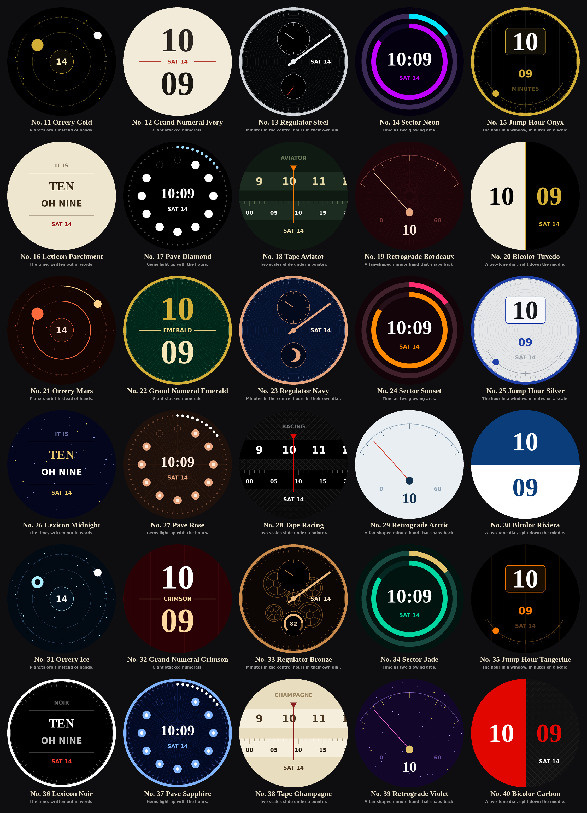
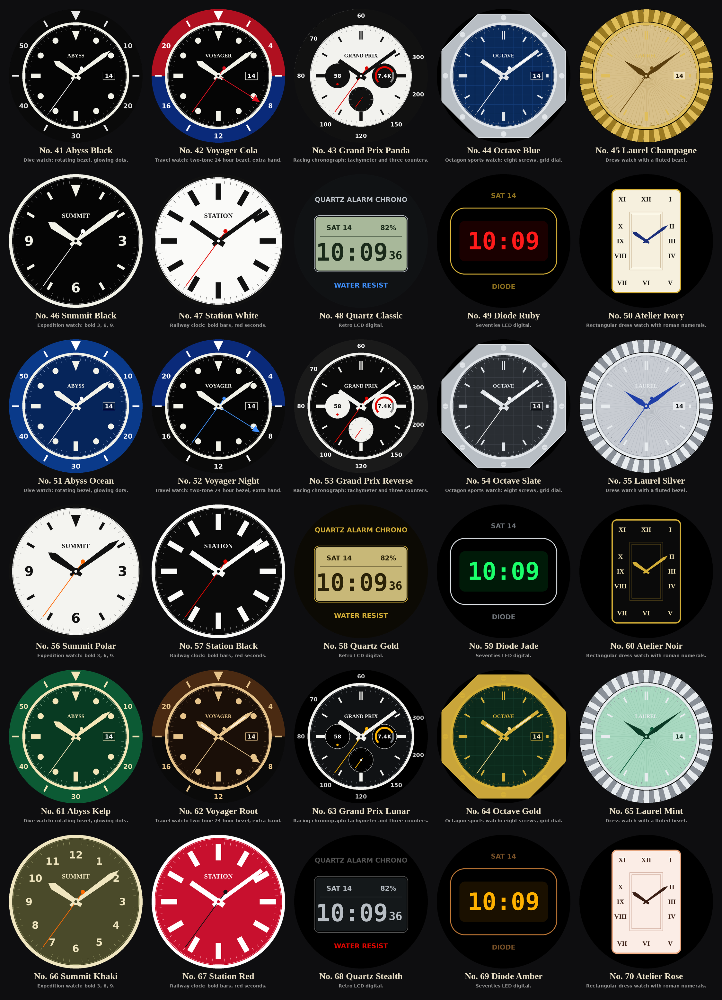

# Maison collection

Seventy luxury Garmin watch faces. Each one is its own Connect IQ app, meant to be sold separately at 0.99.


| Face | Folder | Line for the store |
| --- | --- | --- |
| Aurum | `aurum` | Black and gold. Nothing to prove. |
| Onyx Regent | `onyx-regent` | Polished steel on deep onyx. |
| Meridian Blue | `meridian-blue` | Ocean blue for the yacht club. |
| Rose Sovereign | `rose-sovereign` | Rose gold, cocoa dial, set with gems. |
| Carbon GT | `carbon-gt` | Carbon weave. Track day, then dinner. |
| Emerald Court | `emerald-court` | Racing green and yellow gold. |
| Platinum Reserve | `platinum-reserve` | Silver dial, blued hands, quiet money. |
| Midnight Celeste | `midnight-celeste` | A night sky with a golden moon. |
| Deco Imperial | `deco-imperial` | Art deco digital in black and gold. |
| Ivory Heritage | `ivory-heritage` | Cream enamel and blued steel. |

## Faces 11 to 40

Thirty more, numbered. Ten different layouts, three takes on each, so no two neighbours look alike.



| Layout | Numbers | Idea |
| --- | --- | --- |
| Orrery | 11, 21, 31 | Planets orbit instead of hands |
| Grand Numeral | 12, 22, 32 | Giant stacked numerals |
| Regulator | 13, 23, 33 | Minutes in the centre, hours in their own dial |
| Sector | 14, 24, 34 | Time as two glowing arcs |
| Jump Hour | 15, 25, 35 | The hour in a window, minutes on a scale |
| Lexicon | 16, 26, 36 | The time written out in words |
| Pave | 17, 27, 37 | Gems light up with the hours |
| Tape | 18, 28, 38 | Two scales slide under a pointer |
| Retrograde | 19, 29, 39 | A fan-shaped minute hand that snaps back |
| Bicolor | 20, 30, 40 | A two-tone dial, split in the middle |

Folders are named by number, for example `11-orrery-gold`.

## Faces 41 to 70

Thirty faces inspired by the most famous watch types ever sold. The style is borrowed, the names and details are our own: no brand name, logo or exact dial is copied.



| Layout | Numbers | Inspired by |
| --- | --- | --- |
| Abyss | 41, 51, 61 | The classic dive watch |
| Voyager | 42, 52, 62 | The two-tone travel (GMT) watch |
| Grand Prix | 43, 53, 63 | The racing chronograph and the moon watch |
| Octave | 44, 54, 64 | The octagon steel sports watch |
| Laurel | 45, 55, 65 | The fluted-bezel dress watch |
| Summit | 46, 56, 66 | The expedition and field watch |
| Station | 47, 57, 67 | The railway station clock |
| Quartz | 48, 58, 68 | The cheap, loved LCD digital |
| Diode | 49, 59, 69 | The seventies LED watch |
| Atelier | 50, 60, 70 | The rectangular art deco dress watch |

## What the faces show

- Time, with a sweeping seconds hand on some faces while the watch is awake
- Date window
- Power reserve (battery), moon phase, steps, heart rate or small seconds, depending on the face
- On OLED watches the sleeping screen shows thin outline hands only, to protect the display

All names and designs are original. No real watch brand is copied.

## How it is built

- `faces.json` holds the look of every face.
- `python3 gen.py` writes all the projects (manifest, icon, `Style.mc`) and the mock-ups in `design/`.
- `common/source/LuxFace.mc` is the one renderer all faces share.

Change a colour in `faces.json`, run `gen.py`, done.

## Build one face

```
cd aurum
monkeyc -f monkey.jungle -d fenix7 -o aurum.prg -y your_developer_key.der
```

## Sell them

1. Export each face with your own developer key: `monkeyc -e -f monkey.jungle -o aurum.iq -y your_developer_key.der`
2. Upload each `.iq` to the Connect IQ Store as a separate app.
3. Set the price to 0.99 in the store listing. This needs paid apps enabled on your Garmin developer account.
4. Use `design/<face>.png` as the listing image.

## Images

`design/*.png` are mock-ups drawn by `gen.py`. `design/shots.yaml` holds prompts for ten advertising photos (Azure image generation).
