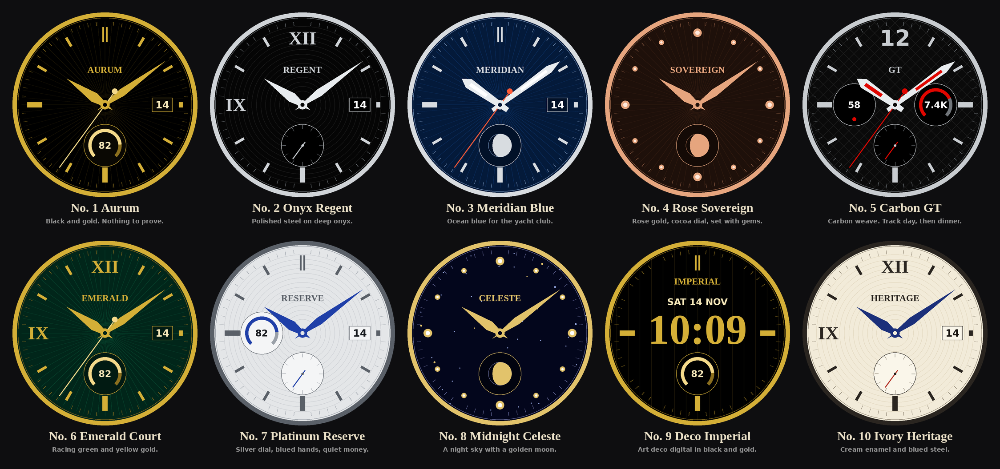

# Maison collection

Forty luxury Garmin watch faces. Each one is its own Connect IQ app, meant to be sold separately at 0.99.



| Face | Folder | Line for the store |
| --- | --- | --- |
| Aurum | `aurum` | Black and gold. Nothing to prove. |
| Onyx Regent | `onyx-regent` | Polished steel on deep onyx. |
| Meridian Blue | `meridian-blue` | Ocean blue for the yacht club. |
| Rose Sovereign | `rose-sovereign` | Rose gold, cocoa dial, set with gems. |
| Carbon GT | `carbon-gt` | Carbon weave. Track day, then dinner. |
| Emerald Court | `emerald-court` | Racing green and yellow gold. |
| Platinum Reserve | `platinum-reserve` | Silver dial, blued hands, quiet money. |
| Midnight Celeste | `midnight-celeste` | A night sky with a golden moon. |
| Deco Imperial | `deco-imperial` | Art deco digital in black and gold. |
| Ivory Heritage | `ivory-heritage` | Cream enamel and blued steel. |

## Faces 11 to 40

Thirty more, numbered, in six styles of five.


| Numbers | Style |
| --- | --- |
| 11 to 15 | Classic dress: roman numerals, engraved dial, small seconds |
| 16 to 20 | Racing chronograph: carbon dial, heart rate, steps, small seconds |
| 21 to 25 | Art deco digital: pinstripes, power reserve |
| 26 to 30 | Celestial: star field, gem markers, moon phase |
| 31 to 35 | Modern minimal: clean dial, date |
| 36 to 40 | Skeleton: gears visible behind the hands |

Folders are named by number, for example `11-sable-regent`.

## What the faces show

- Time, with a sweeping seconds hand on some faces while the watch is awake
- Date window
- Power reserve (battery), moon phase, steps, heart rate or small seconds, depending on the face
- On OLED watches the sleeping screen shows thin outline hands only, to protect the display

All names and designs are original. No real watch brand is copied.

## How it is built

- `faces.json` holds the look of every face.
- `python3 gen.py` writes all the projects (manifest, icon, `Style.mc`) and the mock-ups in `design/`.
- `common/source/LuxFace.mc` is the one renderer all faces share.

Change a colour in `faces.json`, run `gen.py`, done.

## Build one face

```
cd aurum
monkeyc -f monkey.jungle -d fenix7 -o aurum.prg -y your_developer_key.der
```

## Sell them

1. Export each face with your own developer key: `monkeyc -e -f monkey.jungle -o aurum.iq -y your_developer_key.der`
2. Upload each `.iq` to the Connect IQ Store as a separate app.
3. Set the price to 0.99 in the store listing. This needs paid apps enabled on your Garmin developer account.
4. Use `design/<face>.png` as the listing image.

## Images

`design/*.png` are mock-ups drawn by `gen.py`. `design/shots.yaml` holds prompts for ten advertising photos (Azure image generation).
