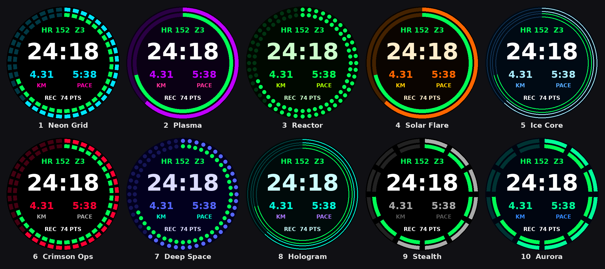

# Pulsar

A futuristic Garmin training app (Connect IQ, Monkey C). It records your workout, reads every sensor the watch has, reacts to gestures and pushes you to train more.



## What it does

- **10 designs.** Colour set plus ring style. Change in Menu > Design, or with a gesture.
- **Motivation coach, opt-in.** Off by default. The app asks once on first launch. Without it you only get plain alerts (lap, goal done, zone guard).
- **Goals.** Time, distance or calories. The outer ring fills as you get closer.
- **Drive Score.** 0 to 100, from heart rate effort and goal progress. Saved into the activity file as a chart.
- **Streak.** Days in a row with a saved workout.
- **Real activity.** Saved to Garmin Connect as Run, Walk, Hike, Bike, Cardio or Strength.

## Buttons

| Action | Result |
| --- | --- |
| START or tap | Start, pause, resume |
| BACK | Lap while recording. Save or discard while paused. Exit when idle |
| UP / DOWN or swipe | Switch screen: HUD, Sensors, Motion, Drive |
| Hold UP (menu) | Settings |

## Gestures

| Gesture | Default | How |
| --- | --- | --- |
| Shake | Motivate me | Shake the wrist fast, two times back and forth |
| Wrist twist | Next screen | Turn the face away and back quickly |
| Face down | Pause / resume | Hold the face towards the ground for 2 seconds |

Each gesture can do: nothing, next screen, lap, pause / resume, motivate me, backlight, next design. Sensitivity has three levels. A gesture fires at most once every 3 seconds.

## Sensors and what they can do

| Sensor | Shown | Option |
| --- | --- | --- |
| Heart rate | HUD ring, zone | Zone guard: alert when under or over Zone 2, 3 or 4 for 30 s |
| Cadence | Sensors screen | Cadence coach: 160, 170 or 180 spm (running) |
| Altimeter | Altitude, ascent | Climb cheers every 25, 50 or 100 m |
| GPS | Distance, pace, lock dot | Route on or off, auto lap each km or mile |
| Pulse Ox | O2 % | Low oxygen alert under 88 % |
| Thermometer | Temperature | Heat alert from 38 C |
| Compass | Heading | Show heading on the HUD |
| Body Battery, stress | Sensors screen | Adaptive coach: calmer when Body Battery is under 30 |
| Barometer, power, respiration, steps | Sensors screen | |
| Accelerometer, gyroscope | Motion screen | Gestures |

A sensor the watch does not have shows `--`.

## Build

Needs the [Connect IQ SDK](https://developer.garmin.com/connect-iq/sdk/).

```
monkeyc -f monkey.jungle -d fenix7 -o pulsar.prg -y your_developer_key.der
```

Copy `pulsar.prg` to `GARMIN/APPS` on the watch, or run it in the simulator. The GitHub workflow builds a `.prg` for every supported watch on each push.

## Design images

`design/previews.png` is drawn by `design/preview.py` from the colours in `source/Themes.mc`.
`design/shots.yaml` holds the prompts for ten AI concept images (Azure image generation).

## Code map

| File | Job |
| --- | --- |
| `PulsarApp.mc` | Start-up, 1 second tick, gesture actions |
| `SensorHub.mc` | Reads all sensors |
| `GestureEngine.mc` | Shake, twist, face down detection |
| `Coach.mc` | Messages and alerts |
| `Workout.mc` | Recording, goal, Drive Score, streak |
| `MainView.mc` | The four screens |
| `Delegates.mc` | Buttons, menus, summary |
| `Themes.mc` | The ten designs |
| `Config.mc` | Settings |
